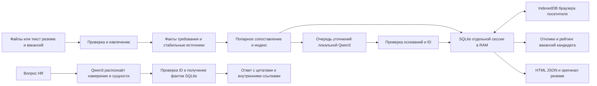

# Архитектура Кадра

FastAPI, HTML/CSS/JS и дочерний процесс llama.cpp работают локально либо на нашем VPS. Постоянное состояние каждого посетителя — IndexedDB его браузера. В браузерном режиме серверная SQLite существует только в RAM; внешние AI API не используются.

## Компоненты

- `documents.py`: лимиты, DOCX с сохранением переносов/табуляций без дублей объединённых ячеек, PDF с текстом, TXT/MD; источники со стабильными ID и исходными цитатами.
- `matching.py`: обязательность, словарь синонимов, составные требования, релевантный стаж и образование, четыре статуса, единая формула. Имена файлов/кандидатов не участвуют в расчёте.
- `service.py`: исходная карта и ограниченный бюджет смысловых уточнений модели; запрет необоснованных повышений и различение неизвестности/отрицания.
- `workspace.py`: SQLite, исходные файлы BLOB, документы и связи, попарные результаты, профиль, первая загрузка семи примеров. Сводные группы карточек независимы от статуса каждого требования. Рейтинг альтернатив использует ту же матрицу и исходную числовую формулу.
- `portal.py`: кабинет, импорт, подробности, экспорт, последовательная очередь задач, автоуточнение и чат. Чат ставится перед ожидающими уточнениями. Запущенный inference не прерывается скрыто.
- `consultant.py`: модель выбирает проверяемое намерение/сущности; сервер строит фактический ответ и безопасные ссылки. Условия из документов не исполняются как инструкции.
- `local_model.py`: закреплённая GGUF/SHA-256, CPU, отключённый thinking, JSON по stdin/stdout; запросы сериализованы, отмена завершает дочерний процесс.
- `exports.py`: автономный HTML со структурой кейса; JSON — все расчёты/источники; скачивание оригинала сохраняет байты, текстовый ввод экспортируется в TXT.
- `static/`: вход по имени, приветствие, вакансии/отклики, база кандидатов, подробности и консультант. SVG-знак, ICO, векторные иконки и фирменная растровая иллюстрация локальны.

## Состояние и границы

По умолчанию `BROWSER_WORKSPACE=1`: SQLite в RAM на отдельную случайную сессию, постоянный JSON-снимок с base64 оригиналов в IndexedDB клиента. Токен передаётся заголовком X-Workspace-Session; сервер не берёт его из URL. Все фоновые задачи, результаты, отмена, чаты и экспорты проверяют владельца. Доступ к старому общему API в публичном режиме закрыт. RAM-копии истекают после30минут бездействия; работающая задача удерживает копию до завершения. Максимум12копий. Модель общая и обрабатывает очередь последовательно, рабочие данные не общие. `BROWSER_WORKSPACE=0` — явный прежний режим SQLite-volume для отдельного локального пользователя; этот volume не включается в поставку.

В момент импорта автоматически рассчитывается первичная карта. При наличии модели ставится ограниченное уточнение в очередь; интерфейс честно показывает первичный результат и фактическое применение ИИ. Для каждого попарного отчёта сохранено только число проверенных требований этой вакансии, общий бюджет не размножается на остальные роли.

Источники берутся из документа по ID, не генерируются. Проверенная цитата не гарантирует правильность смысла. Готовность учиться не становится опытом, общий стаж не профильным, неизвестное не отрицанием навыка. Возраст/пол/гражданство не факторы индекса. Инструмент не отправляет приглашения, отказы или резюме заказчикам.

## Воспроизводимость

Dockerfile закрепляет digest Python3.12, прямые зависимости закреплены версиями, llama.cpp собирается без GPU/native-инструкций конкретного хоста. Compose публикует только loopback8080. Первичная установка использует Docker Hub/PyPI/Hugging Face; обработка и ассеты внешних сервисов не требуют.

Прототип проверяется на Linux arm64 в Docker. Для внедрения нужны испытание целевого CPU, независимая разметка качества, доступ/аудит/сроки хранения, резервное копирование и интеграции. Это план, не действующая промышленная сертификация.

## Локальная речь

`speech.py` предоставляет status, POST `/api/portal/speech/transcribe` (WAV PCM16, mono, 16 кГц, до 60 секунд/2 МБ) и `/synthesize` (текст до 20000 символов → WAV). Веса Vosk/Piper загружаются лениво из read-only `/models/speech`, сеть и автоматическое скачивание при обработке не используются. Общая неблокирующая блокировка сериализует речевые операции и возвращает понятное 429 вместо роста очереди. Консультант и сопоставление используют прежний независимый путь.

`speech.js` + AudioWorklet записывают PCM, приводят к 16 кГц и отправляют в тот же локальный сервер. Перед отправкой в чат требуется явное действие HR. Автоотправки расшифровки нет. Остановка/отмена/уход/скрытие вкладки освобождают микрофон, сетевые запросы можно отменить; при закрытии страницы воспроизведение останавливается. Blob-URL аудио освобождается после воспроизведения/остановки. Аудио не сохраняется в SQLite или файлы приложения. Текст отправленного запроса входит в текущий диалог на тех же условиях, что и ручной ввод.

Golos Text поставляется локально; нейтральные цвета текста и размеры в typography.css, речевые элементы в speech.css. CSP разрешает только локальный worklet и self/blob аудио. Облачные Web Speech API не используются.

## История чатов

Таблица `chats` хранит ID, название по кандидату/вакансии, последовательный порядок без календарных меток, сообщения, контекст, черновик и ID незавершённой задачи. `/api/portal/chats` создаёт/перечисляет диалоги, `/{id}` восстанавливает их, `/{id}/draft` сохраняет редактируемый ввод. `/chat` принимает `chat_id`; прошлые вопросы для модели берутся только из этого диалога на сервере.

Создание задачи атомарно подготавливает вопрос/ID в базе до постановки в очередь. Завершение сохраняет ответ/цитаты/ссылки на сервере, даже если пользователь ушёл со страницы. Повторное или позднее завершение не перезаписывает другой запрос. После перезапуска отсутствующий pending-job превращается в явно прерванный ответ с текстом для повтора. Это не автоматическое продолжение прерванного inference.

Frontend блокирует отправку только в ожидающем диалоге; другие разговоры имеют отдельные сообщения/контекст. Список истории в левой панели, на узком экране — раскрываемый блок. Идентичность первого знакомства хранится в sessionStorage вкладки, постоянные документы/история — в IndexedDB, SQLite отдельной серверной сессии находится в RAM. Корпоративных ролей сотрудников нет.

## Активные документы и интервью

`archived_documents(id,kind)` скрывает запись из `documents()`/`document()` без удаления исходника, связей или вычисленных результатов. DELETE `/api/portal/documents/{kind}/{id}` — обратимое удаление; `/documents/deleted` перечисляет его, POST `/{kind}/{id}/restore` восстанавливает. Восстановление рассчитывает отсутствующие пары с документами, добавленными за время удаления. Повторный импорт удалённого документа предлагает восстановление вместо неявного дубля. Исторические названия чатов могут ссылаться на удалённую тему, действующий контекст очищается.

`candidates()` сортирует базу по максимальному индексу любой активной роли, присваивает места; порядок откликов конкретной вакансии и формула индекса сохранены. `interview.py` формирует практические сценарии и ориентиры проверки по тексту требования. `finalize()` обновляет вопросы и убирает одинаковые темы, сохраняя статусы/баллы/цитаты. Чтение сохранённой evaluation применяет текущую формулировку вопросов без нового inference и без изменения исходной разметки.

`workspace.css` снимает внешние отступы/карточки чата, оставляет одну колонку контекста. Для модального окна ограничена вся цепочка dialog → content → flex-shell → scroll, фон блокируется, внутренний scroll не передаётся странице. Speech-status по умолчанию пуст: виден при записи, обработке или ошибке.

## Долевое соответствие и жизненный цикл подбора

`finalize` пересчитывает старые и новые строки по единой политике `evidence-v2-components`, не меняя оригиналы. `match_fraction` и `unknown_fraction` задают подтверждённую/неизвестную доли веса. Независимые инструменты равнодольны; базовое знакомство даёт половину доли. Для одного технического навыка с≥3деталями основа даёт половину, детали делят вторую. При≥90% и отсутствии отрицаний — full с clarification; остальные компоненты сохраняют partial. Статус до применения компонентов хранится отдельно, повторный пересчёт идемпотентен. Отрицания не становятся неизвестным, подтверждения пересчитываются по цитатам. Веса3/1/1 неизменны.

SQLite мигрируется через CREATE TABLE IF NOT EXISTS: `vacancy_lifecycle(vacancy_id,closed)`, `selections(vacancy_id,resume_id,stage)`. У одной роли несколько выбранных людей, у одного человека несколько ролей; stage selected/contacted — ручные решения HR. Повторная запись selected сохраняет contacted. Закрытая вакансия доступна по прямой ссылке, но исключена из активных рекомендаций; изменения выбора требуют возврата в работу. Удаление документа не уничтожает историю выбора; исходники сохраняются.

PUT `/api/portal/vacancies/{id}/state` принимает closed. PUT `/api/portal/vacancies/{id}/selections/{candidate_id}` принимает stage selected/contacted/remove. Overview отдельно возвращает vacancies и closed_vacancies. Структурированный комментарий безопасно экранируется в UI, выделяются только конкретные недостающие детали.

## Браузерная постоянная копия

`browser-store.js` использует IndexedDB и Web Locks: вкладки одного профиля разделяют кабинет, запросы/снимки сериализованы, старый снимок вкладки не затирает действующую RAM-копию. GET session/config определяет режим; POST session восстанавливает или подсоединяет сессию. GET session/snapshot поддерживает ETag по изменению SQLite. Подтверждение успешного действия UI выдаётся после фиксации снимка в браузере. Черновики вводимых вопросов и сообщений имеют локальные транзакции на input, независимо от последнего запроса при закрытии вкладки.

Снимок — данные фиксированного набора таблиц, не SQLite-файл и не SQL. Восстановление использует белый список колонок, параметры INSERT, проверки формата/числа записей/размера и транзакцию. Превышающий лимит импорт откатывается. Метаданные owner не возвращаются в ответах задач. Экспорты скачиваются через авторизованный fetch как Blob; прямые ссылки чужого кабинета не работают.

В продакшне приложение не публикует8000, Caddy принимает80/443, сертификаты — отдельный volume. Клиентские документы не записываются в volume: read-onlyroot, tmpfsдлявременного, core0, swapконтейнера отключён. ALLOWED_HOSTS задаётся именем сайта; proxy-headers принимаются от внутреннего reverseproxy. Исходные7примеров и веса — общие неизменные данные. Реальные загруженные посетителями файлы на диск не сохраняются.
